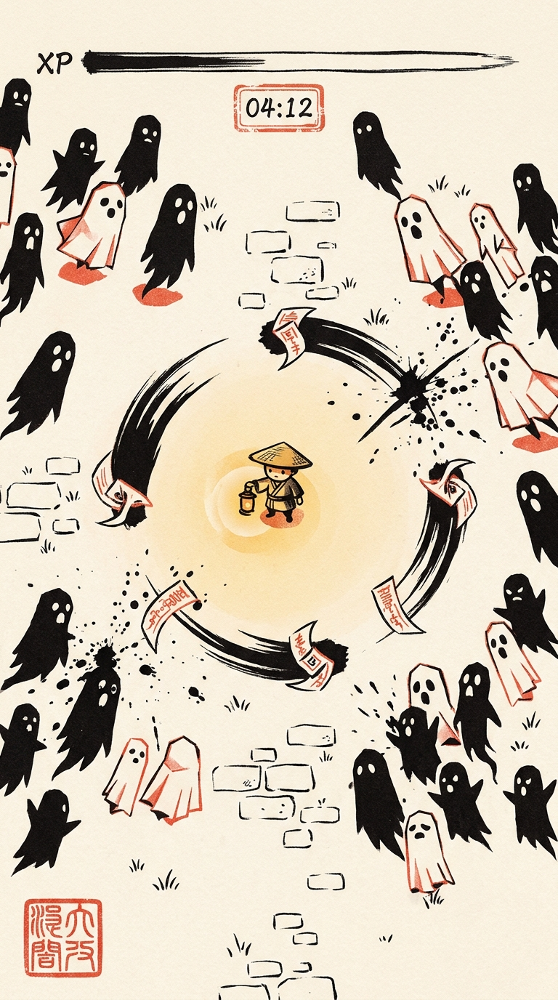
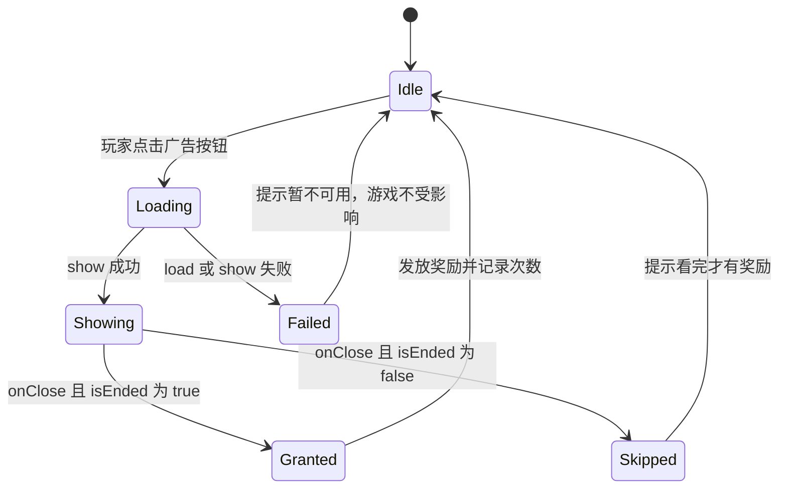

# 《五更天》实施计划

> 竖屏单手 · TapTap H5 · 类幸存者肉鸽 · 纸墨版画民俗风
> 仓库：`/home/antigravity/XuCheri/wugeng`（同步到 GitHub 新仓库 `wugeng`）



> [!NOTE]
> 上图只是**方向参考**，不会直接拿来当游戏素材。游戏里的角色、敌人、特效和 UI 全部用 Canvas 代码绘制，保证风格统一、放大不糊、包体小。参考图里乱码的符文、风格不统一的幽灵这类 AI 痕迹都会去掉。

---

## 1. 已定的设计决策

| 维度 | 决定 |
|---|---|
| 平台 | 纯 H5，零构建（HTML + ES Modules + Canvas 2D），竖屏单手 |
| 美术 | 纸墨版画：墨黑 + 朱红双色印刷，灯笼暖光是唯一的第三色 |
| 世界观 | 打更人守一夜：一更 → 五更 → 鸡鸣天亮 |
| 一局 | 主线 10 分钟（每更 2 分钟）；4:00 和 8:00 各一个精英夜主，10:00 最终 Boss，打败即通关；通关后可选择本局直接进入无尽模式 |
| 操作 | 单指任意位置拖动（浮动摇杆）+ 自动攻击 + 「敲更锣」大招（击杀攒气） |
| 构筑 | 武器 4 槽 + 法器 4 槽；首版 8 种武器、8 种法器；武器 1–5 级；满级武器 + 对应法器 + 打败夜主 → 开光进化 |
| 难度和数值 | 新手第一局大约死在三更到四更，第 3–5 局通关普通难度；主线伤害到几千，无尽模式和高夜色可以一路爆到「万」「亿」 |
| 局外成长 | 铜钱 → 更房 8 项永久加点（满级约 +30%）；英雄靠完成目标解锁；可叠加的「夜色」难度 |
| 首版内容 | 1 张地图「青石镇」；3 位英雄：老周、阿绵、小道童 |
| 广告① 刷新 | 每局 2 次免费刷新（更房最多再加 2 次）；用完后「看广告 +3 次」，每局最多 2 次 |
| 广告② 复活 | 主线 1 次，无尽模式再 1 次：满血 + 自动敲锣清屏 + 无敌 3 秒；结算页可选「看广告铜钱翻倍」 |
| 广告③ 签到 | 「更簿」7 天累计签到，断签不重置；看广告领双倍（第 7 天的外观奖励换成双倍铜钱）；数据存本地 |

---

## 2. 美术与 UI 规范（去 AI 味的硬约束）

### 2.1 色板（全游戏只用这些颜色）

| 名称 | 色值 | 用途 |
|---|---|---|
| 宣纸 | `#EFE6D2` | 底色 |
| 宣纸阴影 | `#E0D2B4` | 纸张纹理、凹陷 |
| 浓墨 | `#1C1A17` | 轮廓、敌人剪影、文字 |
| 淡墨 | `#1C1A17` + 透明度 | 墨晕、夜色遮罩 |
| 朱红 | `#C23B26` | 印章、暴击、血量、重点 |
| 深朱 | `#8E2A1B` | 按下状态、阴影 |
| 灯笼暖光 | `#F0BE62` | **只用在**玩家灯笼光圈和魂火 |

### 2.2 印刷质感（程序生成）
- **纸纹**：启动时生成一块 256² 的噪声纹理，平铺加轻微色斑。
- **套色错位**：朱红层整体偏移 0.5–1px，模拟双色印刷没对准。
- **笔触**：自己写的 `brushStroke()` 函数：粗细随速度变化、起笔和收笔有锋、边缘飞白，用来画刀光、经验条、边框。
- **夜色递进**：每过一更，画面四周的墨晕遮罩加深一档，玩家灯笼光圈越来越显眼；鸡鸣时遮罩褪去，宣纸「亮」起来，这就是通关的视觉高潮。

### 2.3 字体
- 中文：**霞鹜文楷**（SIL OFL 开源授权），用 `pyftsubset` 只保留游戏里用到的字，目标 < 300 KB。如果字体下载不到，就退回系统宋体。
- 数字：自己画的「印章体」数字（计时器、伤害、等级），不用系统字体。

### 2.4 UI 组件（不用玻璃拟态、不用发光、不用 emoji）

| 组件 | 形式 |
|---|---|
| 升级三选一 | 三支竖排「签」（黄纸符签），上面是器物剪影 + 竖排名字 + 一行效果说明；新器物盖朱红「新」字印 |
| 按钮 | 朱红方印或长条印章，按下时下沉 2px 并变成深朱 |
| 面板 | 宣纸卡片加装裱边（上下天地杆） |
| 刷新 | 「换签」按钮，右上角写剩余次数 |
| 广告按钮 | 左上角明确标出「广告」二字 + 水墨画的胶片小图标，文案直接写奖励，比如「看广告 · 再换三次」 |
| HUD | 顶部：笔触经验条 + 印章计时器（显示「三更 · 05:12」）；左下：朱印血量；右下：更锣大招按钮（攒满气会发墨光、轻轻晃动） |
| 伤害数字 | 同一个敌人 0.25 秒内的伤害合并成一个数；普通伤害是小号墨字，暴击用朱红印章「盖」上去；设置里有三档：全显示、只显示暴击、关闭 |

### 2.5 打击感
命中顿帧 30–60ms（只在精英、Boss 和暴击时触发）、屏幕轻震（有上限、可关闭）、墨点飞溅粒子、敌人被打败时化成纸屑或墨烟、拾取魂火有吸附曲线、升级时墨从屏幕中心晕开。

### 2.6 音频（Web Audio 实时合成，不放音频文件）
更锣（低频正弦 + 噪声 + 长衰减）、梆子（短促方波 + 带通滤波）、纸张沙沙（滤波噪声）、墨点飞溅声、鸡鸣前的晨钟；背景乐是五声音阶的类古琴拨弦，按更次逐渐变密。

---

## 3. 局内玩法

### 3.1 时间轴（主线 600 秒）


### 3.2 敌人（青石镇）

| 敌人 | 出现 | 基础生命 | 移速 | 接触伤害 | 特点 |
|---|---|---|---|---|---|
| 纸扎童子 | 一更起 | 8 | 50 | 5 | 杂兵，成群出现 |
| 影祟 | 一更起 | 5 | 85 | 4 | 快、脆，从暗处冲出来 |
| 灯笼鬼 | 二更起 | 32 | 40 | 8 | 肉盾 |
| 黄皮子 | 三更起 | 18 | 70 | 7 | 停顿一下，然后直线扑过来 |
| 纸轿子 | 三更起 | 120 | 30 | 12 | 打破后裂成 4 个纸扎童子 |
| 水鬼 | 四更起 | 45 | 45 | 9 | 从古井爬出，有减速光环 |
| 纸马将军 | 4:00 | 1,800 | 60 | 15 | 蓄力冲锋，三连冲 |
| 无面伞女 | 8:00 | 6,000 | 45 | 18 | 撑伞时减伤，伞面会旋转甩出纸钱弹幕 |
| 夜游神 | 10:00 | 24,000 | 50 | 22 | 三个阶段：召唤 → 弹幕 → 狂暴 |

### 3.3 武器（8 种，每种 1–5 级）

| 武器 | 起手英雄 | 形式 | 1 级 → 5 级要点 | 对应法器 | 开光进化 |
|---|---|---|---|---|---|
| 更锣 | 老周 | 以自身为中心的震波 | 伤害 14→40，半径 70→110，冷却 2.2→1.6 秒 | 梆子 | 五更鸣锣：连震三次，并定身敌人 |
| 灯笼 | — | 环绕灯笼，接触持续灼烧 | 灯笼 1→3 盏，每 0.5 秒 8→20 伤害 | 香炉 | 长明灯：常驻火环，被烧死的敌人会爆开 |
| 符纸 | 小道童 | 自动追踪的弹体 | 每次 1→4 张，伤害 12→26 | 朱砂 | 天师符阵：符纸可穿透，命中时连锁 |
| 墨笔 | — | 朝移动方向的扇形挥砍 | 伤害 20→55，角度 90°→150° | 砚台 | 泼墨山河：前后两刀，在地上留下墨迹持续伤害 |
| 铜钱剑 | — | 回旋穿透 | 伤害 16→42，1→2 把 | 八卦镜 | 七星剑阵：七剑环绕后齐射 |
| 纸人 | 阿绵 | 召唤物，冲向敌人 | 1→3 个，伤害 10→28 | 剪刀 | 纸扎仪仗：一队 8 个纸人巡游 |
| 爆竹 | — | 抛向敌人密集处，范围爆炸 | 伤害 30→80，冷却 2.6→1.8 秒 | 火折子 | 满堂红：连环爆炸 |
| 铜铃 | — | 在敌人之间弹跳连锁 | 弹跳 3→7 次，伤害 11→30 | 红绳 | 千铃引魂：每次弹跳分叉 |

### 3.4 法器（8 种，每种 1–5 级）

| 法器 | 每级效果 | 5 级合计 |
|---|---|---|
| 梆子 | 冷却 −8% | −40% |
| 香炉 | 范围 +10% | +50% |
| 朱砂 | 伤害 +8% | +40% |
| 砚台 | 持续时间和弹速 +10% | +50% |
| 八卦镜 | 护甲 +1，最大生命 +10 | +5 护甲，+50 生命 |
| 剪刀 | 数量：2 级和 5 级各 +1；其余每级伤害 +4% | 数量 +2 |
| 火折子 | 经验 +8%，拾取范围 +10% | +40% / +50% |
| 红绳 | 暴击率 +5% | +25% |

### 3.5 「敲更锣」大招
- 攒气：满气 100；打败普通敌人 +1，精英 +10（老周的攒气速度 +25%）。
- 释放：半径 220 的震波，伤害 = 60 + 10 × 角色等级，附带击退；**主线大约每 60–90 秒能放一次**。

### 3.6 拾取物
魂火（经验，分三档大小）、铜钱（普通敌人 4% 概率掉落，精英必掉）、包子（打碎路边的纸灯笼柱后掉落，回复 30 生命）、招魂幡（把全屏魂火吸过来）、供盒（夜主掉落：满足条件就开光进化，否则随机升级 1–3 件器物）。

---

## 4. 数值模型

### 4.1 经验曲线
$$\text{XP}_{\text{next}}(L) = 5 + 6(L-1) + 0.35(L-1)^2$$
- 升到 33 级累计约 6,800 经验，对应主线大约 32 次升级。
- 器物全部满级需要 40 次选择（4 武器 × 5 级 + 4 法器 × 5 级），**主线升不满所有器物，所以每次选择都有分量**；剩下的留给无尽模式。

### 4.2 伤害公式
$$D = B_w(\ell)\times(1+\Sigma\text{增伤}\%)\times\text{Crit}\times M_{\text{开光}}$$
- 增伤%（朱砂、更房、英雄特性）全部**加算**，只有开光倍率（×1.5–2.0）是乘算，防止数值失控。
- 暴击：基础 5%，暴击倍率 ×2。
- 受到伤害 = max(1, 原始伤害 − 护甲)。
- 冷却 = 基础冷却 × max(0.55, 1 − Σ冷却缩减)。

### 4.3 敌人成长与刷怪
- 敌人生命：$HP = HP_{base}\times(1+0.10m)\times(1+0.15N)$，其中 m 为已过分钟数，N 为夜色等级。
- 每秒刷怪数：$S(m) = 1.2 + 0.55m + 0.035m^2$（10 分钟时约每秒 10 只），同屏上限 260 只（受性能约束）。
- 后期的压力主要靠**敌人种类更替**（更肉、更快的敌人）来抬高，而不是单纯堆血量，这样画面始终读得清。

### 4.4 平衡验收（用模拟器校准，不靠拍脑袋）
`tools/simulate.mjs` 无界面跑 1,000 局，机器人走位策略是「风筝 + 吃魂火 + 每次升级按简单评分挑选」：

| 指标 | 目标 |
|---|---|
| 不带局外成长时的死亡时间中位数 | 5:00–7:00 |
| 不带局外成长时的通关率 | 5–15% |
| 局外成长到 50% 时的通关率 | ≥ 60% |
| 压力比 = 每秒涌入的敌人总血量 ÷ 玩家 DPS | 非 Boss 时段保持在 0.6–0.95 |
| 主线最高单次伤害 | 1,000–5,000 |

### 4.5 无尽模式：数字可以一路爆
- 10:00 之后，敌人生命按分钟乘算：$\times 1.22^{k}$（k 为进入无尽后的分钟数）。
- 器物全部满级后，每次升级改为「溢出签」（伤害 ×1.12，乘算），保证玩家一直追得上。
- 超过 1 万的数字显示成「1.2万」「3.4亿」；大约无尽第 20 分钟到「万」级，第 35 分钟以后到「亿」级。

### 4.6 局外成长：更房（8 项 × 5 级）
体魄（生命 +5%/级）、力道（伤害 +3%/级）、脚力（移速 +3%/级）、眼力（拾取 +6%/级）、悟性（经验 +3%/级）、财运（铜钱 +5%/级）、机缘（2 级、4 级各 +1 次免费刷新）、护持（3 级、5 级各 +1 护甲）。
- 价格：$\text{Cost}(\ell) = \lfloor 60\,\ell^{1.6}\rfloor$ → 60 / 181 / 347 / 553 / 794，单项满级约 1,935，全部满级约 1.55 万铜钱。
- 收入：一局死在 6 分钟约 150 铜钱，通关约 350，看广告翻倍后 ×2 → 全部满级大约需要 40–60 局。

### 4.7 英雄和夜色

| 英雄 | 解锁条件 | 起手武器 | 特性 |
|---|---|---|---|
| 打更人·老周 | 默认 | 更锣 | 大招攒气 +25% |
| 纸扎匠·阿绵 | 单局打败 800 只敌人 | 纸人 | 召唤物伤害 +20%，最大生命 −10% |
| 小道童 | 不吃一个包子守到五更（撑到 8:00） | 符纸 | 暴击率 +10% |

**夜色 1–10**：通关当前等级后解锁下一级。每升一级，敌人生命 +15%、精英更频繁，并额外叠加一条词缀（如「影祟加速」「包子减半」）；铜钱收益每级 +15%。

---

## 5. 广告设计（合规第一）

### 5.1 广告位汇总

| 广告位 | 触发时机 | 奖励 | 上限 |
|---|---|---|---|
| 换签 | 免费刷新次数用完后，三选一界面上 | 再刷新 3 次 | 每局 2 次 |
| 复活 | 死亡时 | 满血 + 清屏 + 无敌 3 秒 | 主线 1 次，无尽模式再 1 次 |
| 结算翻倍 | 结算页 | 本局铜钱 ×2 | 每次结算 1 次 |
| 更簿双倍 | 每日签到 | 当天奖励 ×2 | 每天 1 次 |

### 5.2 合规规则
- 广告全部由玩家主动点击，按钮上明确写「广告」；绝不自动弹出，也不做插屏和 Banner。
- 只有 `onClose` 回调里 `isEnded === true` 时才发奖励；中途关闭就提示「看完才能领取奖励」，不扣任何东西。
- 加载失败或拉不到广告：提示「广告暂时不可用」，游戏照常进行；复活界面始终有「不了，结算」按钮。
- 每局前 60 秒不显示任何广告按钮；播放广告时游戏暂停、静音。
- **ICP 开关**：`src/ads/ads-config.js` 里的 `rewardedAdUnitId: ""` 时，所有广告入口**直接隐藏**（离线模式）。这样在 ICP 办下来之前就能先提审上架，办好后填上广告位 ID 再发版。
- 开发测试用 `?mockAds=1` 模拟广告的完整流程。

### 5.3 广告状态机



---

## 6. 技术架构

```
wugeng/
├── index.html              # 入口：Canvas + DOM 菜单层
├── styles.css              # 菜单和面板样式（宣纸、装裱、印章）
├── privacy.html            # 隐私政策
├── assets/fonts/           # 裁剪后的霞鹜文楷
├── src/
│   ├── main.js             # 启动、固定步长主循环（60Hz 逻辑 / 按显示器刷新率渲染）
│   ├── core/               # rng.js（可设种子）、math.js、pool.js（对象池）、spatial-hash.js
│   ├── sim/                # 纯逻辑，不碰 DOM，可在 Node 下运行
│   │   ├── balance.js      # 所有数值表和常量集中放在这里
│   │   ├── run.js  player.js  enemies.js  spawner.js
│   │   ├── weapons.js  relics.js  evolutions.js  projectiles.js
│   │   ├── xp.js  levelup.js（三选一的权重和保底）  endless.js
│   ├── render/             # ink.js（纸纹、笔触、套色错位）、sprites.js（程序绘制的精灵缓存）
│   │                       # renderer.js、fx.js（顿帧、震屏、墨点）、hud.js、damage-text.js
│   ├── ui/                 # 标题、更房、更簿、英雄选择、三选一、暂停、复活、结算、设置、适龄提示
│   ├── audio/synth.js      # Web Audio 合成
│   ├── meta/               # save.js（带版本号的本地存档 + 迁移）、checkin.js、unlocks.js、shop.js
│   └── ads/                # ads.js（沿用《末班货车》已经验证过的接口约定）、ads-config.js
├── tools/
│   ├── simulate.mjs        # 平衡模拟器
│   └── package_h5.py       # 打出符合 TapTap 要求的 ZIP（单个顶层目录 + index.html）
├── tests/                  # node --test 单元测试
└── e2e/                    # Playwright 冒烟测试 + 截图
```

- **逻辑和渲染分离**：`sim/` 是可设种子的确定性纯逻辑，测试和模拟器直接调用它，保证「数值合理」可以验证。
- **性能预算**：300 个敌人 + 400 个弹体保持 60fps。手段是空间哈希碰撞、对象池、精灵预先渲染到离屏 Canvas、DPR 最高到 2、提供低画质开关。
- **适龄与隐私**：启动页放可点击的 CADPA **12+** 适龄标识（题材有民俗鬼怪元素，但没有血腥），并提供本地隐私政策弹窗。

---

## 7. 开发里程碑

| 阶段 | 内容 | 验收 |
|---|---|---|
| M0 | 建仓库和 GitHub、写渲染原型（纸纹、笔触、老周、两种敌人） | **画面风格检查点：发截图给你确认后再继续** |
| M1 | 核心循环：移动、3 种武器、4 种敌人、经验和三选一 | 能完整玩一局 |
| M2 | 全部内容：8 武器、8 法器、开光、3 个 Boss、五更节奏、大招 | 能通关主线 |
| M3 | 写模拟器，校准数值 | 达到 4.4 节的全部指标 |
| M4 | 局外：更房、英雄解锁、夜色、无尽模式、存档 | 存档迁移测试通过 |
| M5 | 广告：换签、复活、结算翻倍、更簿 | 广告次数上限和失败兜底测试通过 |
| M6 | 打磨：音频、打击感、设置、隐私和适龄、性能 | 中端机压力测试达到 60fps |
| M7 | 打包上架：ZIP、商店素材（和游戏画风一致）、创建 TapTap 游戏 | 提交审核 |

> [!IMPORTANT]
> 涉及 TapTap 的不可逆操作（创建新游戏、提交审核、上线）都会**先给你看预览，等你确认后再执行**。新游戏需要**单独**办理「小游戏前置备案」（约 20 个工作日），建议 M0 阶段创建游戏草稿后就开始办，和开发同时推进。

---

## 8. 验证方案

**自动化**
- `node --test`：经验曲线、伤害公式、冷却下限、开光条件、三选一权重和保底、刷新和复活次数上限、更簿跨天和断签逻辑（包括本地时间被改的情况）、存档迁移、同一种子跑两次结果一致。
- `node tools/simulate.mjs --runs 1000`：输出死亡时间分布、通关率、压力比曲线，任何一项超出 4.4 节的范围就算失败。
- Playwright（390×844 和 360×780 两种竖屏尺寸）：从启动到通关的完整流程、模拟广告的三条路径（看完、中途关闭、失败）、离线模式下广告入口隐藏、每个界面截图。
- 压力测试：强制同屏 300 敌 + 400 弹体，记录帧时间。

**人工**
- M0 风格检查点由你确认截图。
- 打包后用 TapTap 测试二维码真机试玩：单手操作、刘海屏安全区、声音、切到后台再回来。

---

## 9. 首版明确不做
英雄形态、第二张地图、联网排行榜和云存档、内购、插屏和 Banner 广告。都留到上线收集到反馈之后再决定。
